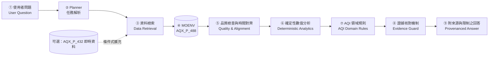

# 台灣空氣品質證據分析代理人專題提案
**英文題目：Taiwan Air Quality Evidence Agent for Traceable Local Air-Quality Analysis**

---

## 提案摘要（Abstract）

### Attention Getter（Motivation）
世界衛生組織（WHO）指出，空氣污染是全球首要的環境健康風險因子，每年造成約 660 萬人死亡；其中近 84% 的空污相關死亡來自心血管疾病、中風、慢性阻塞性肺病（COPD）及肺癌等非傳染病。 WHO 亦估計，全球約 99% 人口暴露於超過其 PM2.5 年均 guideline（5 μg/m³）的空氣品質，顯示空污風險具有高度普遍性。

此外，State of Global Air 2025 估計，印度與中國合計占全球空污相關死亡負擔的 56%，凸顯高污染地區的公共衛生負擔高度集中。 空氣污染同時被 WHO 視為僅次於菸草的全球非傳染病風險因子，因此建立即時、可信、可追溯的空氣品質資訊系統，具有明確的公共衛生與政策價值。

### But（Challenge）
環境部已開放 AQX_P_488「空氣品質指標（AQI）歷史資料」，提供各測站逐時 AQI、PM2.5、PM10、O3、SO2、CO、NO2、風速、風向、經緯度及資料建立時間等欄位。 然而，使用者仍須自行處理測站對齊、時間戳記、污染物單位、移動平均值、AQI 等級判定及資料缺漏等問題；若直接將原始資料交由生成式 LLM 回答，容易產生站點、時間或數值錯配。

純生成式 LLM 也存在明顯的數值與事實幻覺風險。2025 年 ACL 研究指出，即使是表現較佳的 LLM，在不同領域仍可能對 3%–86% 的事實陳述產生幻覺，顯示語言流暢並不等於數值正確。 雖然 Retrieval-Augmented Generation（RAG）可降低幻覺，但研究顯示其並無法完全消除錯誤：一項公共衛生領域的 MEGA-RAG 研究透過多源檢索、重排序與證據不一致檢查，將幻覺率降低逾 40%；另一項 RAG 忠實性研究則發現，即使提供正確上下文，最先進方法仍未必能達到 80% 以上的事實正確率。

既有空品 Agent 亦尚未完全解決台灣在地需求。Neuro-Air 是 2026 年發表於 npj Clean Air 的多代理 LLM 框架，結合即時空污資料檢索與持久化程式執行沙箱，並透過協調代理調度多個領域代理處理都市空污管理任務。 不過，其資料範圍、任務設計與評估情境並非針對台灣環境部站級逐時資料、台灣 AQI 規則、資料衝突偵測及可拒答機制而設計。

### Cure（Proposed Solution）
本研究提出一個 Tool-augmented Evidence Agent，結合環境部逐時觀測資料檢索、確定性數值分析工具（Deterministic Analytics）、台灣 AQI 領域規則與受限 LLM。系統將語言理解、資料檢索、數值計算與規則判定明確分工：LLM 負責理解使用者意圖、組織證據與生成說明；確定性工具負責查詢、對齊、計算、比較與規則判定。

具體而言，系統以 (SiteId, DataCreationDate) 作為唯一觀測鍵值，避免同名測站、行政區混淆或跨小時、跨更新批次的數值錯配。 當使用者詢問某測站於特定時間的 AQI、主要污染物、濃度變化或空品等級時，Agent 必須先檢索對應原始觀測，再由確定性工具完成計算與規則判斷，最後才由 LLM 產生附帶來源、時間、測站與計算依據的回答。

若資料不足、時間範圍不支援、測站不存在，或同一觀測鍵值下出現數值衝突，系統將優先採取證據連結的拒答（evidence-linked refusal），而非讓 LLM 自行推測或補完數值。此設計直接回應 LLM 在高風險、數值敏感任務中的幻覺問題。

### Development（Method）
本研究將系統拆分為四個模組：
- **資料檢索模組**：從環境部 AQX_P_488 逐時資料集中，依 SiteId、County、時間範圍與污染物欄位檢索觀測值。
- **資料清理與對齊模組**：以 (SiteId, DataCreationDate) 建立唯一觀測鍵值，處理重複紀錄、缺值、單位、時間戳記與跨批次更新問題。
- **確定性分析模組**：執行 AQI 等級判定、污染物比較、時序變化、移動平均、極值查詢及異常偵測；所有數值結果均由程式計算，而非由 LLM 直接生成。
- **受限生成模組**：LLM 僅能根據已驗證的證據與工具輸出撰寫回答，並須標註測站、時間、資料來源、計算依據；無法驗證時必須明確拒答。

此架構的創新之處，在於不是僅將 LLM 與 RAG 結合，而是將「語言理解」與「數值可信性」徹底分離，並以台灣 AQI 規則作為領域約束。

### Experiments（Evaluation）
本研究規劃建立 60 題台灣在地空品測試集，包含：
- **45 題可回答題**：涵蓋單一測站即時或歷史 AQI、主要污染物、濃度變化、跨日比較、區域概況及 AQI 等級判定。
- **15 題資料不足／衝突／拒答題**：涵蓋測站不存在、時間超出資料範圍、欄位缺漏、同一觀測鍵值數值衝突，以及無法由既有規則安全推論的問題。

實驗將比較三種模式：

| 模式 | 說明 | 預期評估重點 |
| :--- | :--- | :--- |
| **LLM-only** | 僅使用 LLM 直接回答 | 數值正確率、幻覺率、來源可追溯性 |
| **Deterministic Tools Only** | 僅使用確定性工具與規則 | 計算正確性、規則一致性、自然語言可用性 |
| **Proposed Agent** | 檢索 + 確定性工具 + 台灣 AQI 規則 + 受限 LLM | 整體正確率、拒答正確性、證據可追溯性、衝突偵測 |

評估指標將包括回答正確率、數值正確率、AQI 等級判定正確率、來源引用正確率、拒答正確率，以及資料衝突偵測率。此設計可檢驗系統是否不僅「能回答」，更能判斷「何時不應回答」。

### Findings（Expected Outcomes）
目前 Proposal 階段尚未進行 Agent 實驗，因此所有成效均標註為待驗證。現階段已完成 2026/1/1 至 2026/10/29 共 970,296 筆原始資料清理，保留 606,137 筆獨立觀測，並隔離 13 組數值衝突。

這些前置成果顯示，台灣逐時空品資料確實存在重複、缺漏、時間對齊與數值不一致等實務問題；若未建立確定性驗證與拒答機制，LLM 可能將不完整或衝突資料轉化為看似合理但錯誤的回答。本研究預期，相較於 LLM-only 與 Deterministic Tools Only，本 Agent 能在維持可用性的同時，提高數值正確性、來源可追溯性與拒答可靠性。

---

## 1 緒論 (Introduction)

### 1.1 研究動機 (Research Motivation)
世界衛生組織（WHO）於 2021 年發布修訂之《全球空氣品質指引》[12]，並於 2025 年政策摘要中進一步警告，空污暴露與全球近八分之一的死亡直接或間接相關，包括缺血性心臟病、中風、慢性阻塞性肺病及肺癌等嚴重疾病 [13]。

在台灣，環境部（MOENV）長年營運全台空氣品質監測網，並透過「環境部空氣品質歷史資料（AQX_P_488）」釋出測站每小時之 AQI、主要污染物濃度、氣象觀測（風向、風速）、地理座標與測站編號 [9]。這套資料庫為大眾與科研人員追查「何時、何地、何種污染物發生變化」提供了詳實的基礎。然而，當一般民眾或專題研究者欲取得特定時空的空品摘要時，現有查詢界面通常僅支援單一測站、單一日期的列表下載或靜態圖表瀏覽，解讀者往往必須耗費大量精力手動對齊測站、解析時間尺度，並自行研判數據背後是否面臨缺值或重複上傳之品質問題。

### 1.2 領域與使用者背景 (Domain and User Background)
本專題鎖定的主要目標受眾包含：(1) 想理解台灣特定生活圈空品變化與健康建議的一般大眾；(2) 需要快速檢核環境監測資料、對比測站差異的大專院校師生與課堂專題研究者。

在空氣品質領域中，台灣環境部採用的空氣品質指標（AQI）是透過監測二氧化硫（SO2）、一氧化碳（CO）、臭氧（O3）、二氧化氮（NO2）及懸浮微粒（PM10、PM2.5）等多項污染物濃度，分別計算各污染物副指標後，取其最大值作為該測站當小時之 AQI，並據此定義當前指標之主要污染物 [10]。AQI 是高度綜整之宏觀指標，但單一數值本質上會遮蔽其他未主導指標之污染物資訊；再者，固定測站量測之數值僅代表監測站周邊微環境大氣狀態，絕不等同於個別民眾全天穿梭各微環境之「個人實際吸入暴露量」[11][13]。因此，一個負責任且具備科學誠信的空品系統，在呈現 AQI 的同時，必須忠實保留主要污染物、對應之時間視窗、測站來源與資料局限性。

### 1.3 問題定義 (Problem Definition)
給定使用者以自然語言提出的時空查詢問題 $Q$，其可能包含特定地點、測站代碼、時間範圍及指定污染物：
$$\text{Query } Q \rightarrow (\text{Location } L, \text{ TimeWindow } [T_s, T_e], \text{ Pollutant } P, \text{ Intent } I)$$
系統如何從公開的環境部逐時觀測資料庫中，自主解析並執行確定性檢索與數值分析，產出結構嚴謹、每項主張皆能精準回溯至特定測站觀測列（Row-level Provenance）的趨勢、事件或測站對比說明，且在面對「資料不足」、「數值衝突」或「問題超出資料科學能力（如索取因果歸因或醫療診斷）」時，能確定性地觸發防護機制並明確宣告資料限制？

### 1.4 現有方法的限制 (Existing Limitations)
目前針對台灣空品資料的應用與分析途徑主要存在以下局限性：
1. **傳統公開資料頁面查詢**：官方資料平台僅提供原始數值展示或批次 CSV 下載，缺乏跨站聚合與自動化趨勢解讀能力。使用者若要分析跨日或多站差異，必須自行撰寫程式或手動整理，且需自行承受原始資料中隱含的缺值、重複寫入與格式不一致問題。
2. **純生成式大型語言模型（LLM-only）**：生成式模型具備卓越的語言組織與通順度，但在面對精確時空與環境數值時，極易產生「數值幻覺（Numerical Hallucination）」，經常憑空捏造測站讀值或計算出錯誤的變化百分比；更重要的是，其輸出文字缺乏直接鏈結到資料庫列級（Row-level）的證據鏈，無法供使用者獨立稽核。
3. **既有空品 Agent 與預測研究的局限**：近期國際上已出現如 Neuro-Air [1] 等多代理空品系統，但其主要建基於香港與河北省跨來源資料集，任務流程與台灣環境部特有的 AQI 法定計算規範不同，且其龐雜的多代理協商架構超出單一專題的可重現驗證範疇；另一方面，台灣既有機器學習研究（如 PM2.5 數值預測 [4]、AirBox 空間校正 [5]）均聚焦於統計數值指標改善，不支援自然語言的可追溯問答與證據鏈核對。

### 1.5 本專題的研究方法 (Proposed Methodology)
本專題將 Agent 的語言理解與數值計算分開：
1. **Planner**：將自然語言問題轉成結構化的測站、時間窗與分析任務。
2. **資料工具**：取得並驗證歷史紀錄。
3. **統計與規則工具**：計算趨勢和差異。
4. **AQI 領域規則**：約束並引導解讀。
5. **語言模型**：僅將已驗證的結果組織成自然語言回答。

每一項數值結論都要附帶測站、時間與來源依據。系統不會根據相關性推論污染來源，也不提供個人醫療診斷。

### 1.6 預期貢獻 (Expected Contributions)
1. 建立一套保留原始資料、可重跑並記錄資料品質處理的 AQX_P_488 準備流程。
2. 實作可依問題呼叫資料檢索、趨勢分析、測站比較與 AQI 領域規則的 Agent 原型。
3. 建立一組針對台灣 AQI 歷史資料的可回答與不可回答問題，檢查數值與來源是否吻合。
4. 比較語言模型直接回答、確定性工具輸出與工具型 Agent，整理其失敗案例和適用範圍。

---

## 2 相關研究 (Related Work)

### 2.1 研究摘要表

| 文獻 (年份) | 問題與資料集 | AI 方法 | 領域知識 | 研究發現 | 本專題相關限制 |
|---|---|---|---|---|---|
| **[1] (2026)** | 多來源空品決策支援 (香港/河北 317題) | LLM 多角色協調 + Python 執行環境 | 排放、氣象與決策 | 多步驟分析可行；因果/暴露需專家審查 | 跨區資料；多代理架構超出專題範圍 |
| **[2] (2025)** | 時序異常偵測與解說 (韓國空品監測網) | 序列切片 + DTW / Z-score + LLM | 空品時序、鄰站一致性 | 維持召回率下 FPR 降低 >50% | 僅異常偵測；未驗證逐項紀錄來源 |
| **[3] (2025)** | AQI 預測與可解釋性 (印度多元觀測時序) | Random Forest + ARIMA + SHAP | 污染物特徵時序 | MSE 508.46、R² 0.94，優於基準 | 著重預測；指標無法對比問答正確率 |
| **[4] (2020)** | 台灣測站 PM2.5 預測 (77空品站/580氣象站) | Gradient Boosting + 氣象特徵 | 台灣地形、季風、排放 | 加入電廠特徵後 R² 達 0.71 | 重點為數值預測；不支援自然語言追溯 |
| **[5] (2023)** | 台灣 AirBox 空間校正 (2020 逐時 EPA/AirBox) | 空間變動係數 (SVC) 模型 | TAQMN 參考站、空間異質 | RMSE 改善 38%–68% 並附不確定度 | 聚焦 PM2.5；微型感測結果無法直套官方站 |
| **[6] (2025)** | 低成本感測器校正評估 (TSI 與參考儀器共置) | 線性/非線性校正 + Bland-Altman | PM2.5/NO2/O3 等表現 | 溫濕度改善不一致；非線性易過擬合 | 型號與環境強烈依賴；無法跨站直接轉移 |
| **[7] (2025)** | 感測器實地部署前後變化 (11 戶 19 顆 Plantower) | 前後校正對比 + 迴歸分析 | 濕度、溫度、暴露累積 | 濕度與時長顯著影響斜率；暴露影響截距 | 住宅內部數據；無法直接推論台灣官方站 |
| **[8] (2025)** | 感測器相對濕度偏差估算 (布里斯本 PMS7003) | 雙感測器 + 乾燥器 | 滾動修正因子、吸濕性氣膠與光學散射 | 經乾燥後所報 PM2.5 降低 25%–40% | 概念驗證階段；缺乏長期跨季跨成分驗證 |

### 2.2 研究綜合與 Research Gap
現有研究已分別處理台灣 PM2.5 預測、AirBox 空間校正、時間序列異常偵測和多代理空品決策支援。[1][2][4][5] 這表示「將 LLM 接上空品資料」或「Agent 能執行分析」本身不足以構成新穎性主張。

**本專題採用的 Research Gap：**
> 在本次檢視的研究中，尚未看到以環境部 AQX_P_488 歷史檔案為基礎，專門評估台灣 AQI 地點／時間問答的基準集，並同步檢查數值、測站、時間和來源紀錄的系統性實驗。

此處描述的是目前文獻檢索範圍內的研究空缺，不宣稱全球沒有其他相似工具。專題將以「在本地資料和領域規則下進行可重現的整合與評估」作為課堂研究貢獻，不宣稱提出新的 Agent 架構。

---

## 3 Deep Research

### Q1 五個核心思維模式
1. **AQI 是多污染物摘要，不是完整的污染物清單**：環境部依多種污染物濃度換算副指標，再以最大副指標形成 AQI。[10] 因此，只顯示 AQI 可能隱藏造成指標的污染物。系統應同時呈現 AQI、來源所列主要污染物及可取得的濃度／平均時間；若欄位不足，需明說資料沒有提供所需細節。
2. **測站讀值只代表測站周遭的監測條件**：測站位置、鄰近道路、建物和空氣流動會影響讀值的空間代表性；個人暴露還受人在不同地點停留時間影響。[11][13] 系統可以比較指定測站或附近測站，但不得把單一站點讀值寫成使用者的個人暴露量。
3. **量測來源與品質決定資料能回答什麼**：監測站、低成本感測器及經過校正的感測器有不同品質條件。EPA 建議依監測目的選擇感測器位置，並透過共置評估感測器表現；2025 年校正研究也顯示模型的驗證表現會因污染物與環境條件改變。[6][11] 本專題以環境部站點資料為主，將 IoT 感測資料留作條件式擴充，除非能確認站點對應與品質資訊。
4. **必須對齊時間尺度再比較**：環境部 AQI 涵蓋不同污染物及其指定的平均時間；WHO 指引也明確區分短期與長期平均。[10][12] 系統要標示台灣時區、資料時間窗與所使用的聚合方式，不把逐時值、8 小時平均和 24 小時平均當成同一種量。
5. **時空相關性不能單獨證明污染來源或健康因果**：風向、站點差異與污染物變化可協助描述同時發生的現象，但來源歸因需要更完整的排放、氣象與傳輸模型。Neuro-Air 也指出，來源歸因、空間暴露及健康判斷仍存在專業限制。[1] 本專題只報告資料支持的時序或站點模式；不把風向相關性寫成污染源證明，也不給個人診斷。

### Q2 三個重要專業爭論
* **爭論一：低成本感測網路可以取代參考級測站嗎？**
  * *支持擴大低成本網路*：成本較低、空間密度較高，可能補足官方站點之間的局部觀測。台灣 AirBox 校正研究以空間自適應方法，報告 PM2.5 預測 RMSE 改善約 38%–68%。[5]
  * *支持維持參考級測站*：低成本讀值受感測器型號、校正、濕度、部署時間和安裝位置影響。EPA 將低成本感測器定位為依目的使用、須檢查品質的資訊來源；2025 年研究也指出校正效果未必能通過獨立驗證。[6][7][11]
  * *目前共識*：低成本網路能補充較密集的空間資訊，但應與參考級監測、共置驗證及明確品質說明搭配。
  * *未解問題*：校正如何跨地點、季節和不同粒子組成轉移？本專題的核心分析只用官方資料，不把未驗證感測器加入真值。
* **爭論二：空品校正應優先採用簡單模型還是複雜機器學習？**
  * *支持複雜模型*：非線性模型可能捕捉溫度、濕度、污染物濃度和感測器輸出的交互作用。台灣研究顯示，校正策略可改善 AirBox PM2.5 預測表現。[5]
  * *支持簡單模型*：複雜模型在訓練資料上表現好，不代表能處理未見地點或部署後的讀值。Dong 等人的 2025 年驗證指出，溫濕度加入後的改善不一定在驗證資料維持，部分非線性模型有過度擬合疑慮；Fang 等人發現部署前後校正斜率會改變。[6][7]
  * *目前共識*：應以獨立時間或站點驗證決定方法，不能只報訓練集表現。
  * *未解問題*：如何在準確度、可解釋性和跨站移轉間取捨？本專題先比較確定性分析與簡單基準，不以感測器校正作為必要功能。
* **爭論三：空品 Agent 應由 LLM 自由推理，還是讓程式工具負責計算？**
  * *支持較自主 Agent*：多代理系統可以把資料工程、分析和解說拆成不同任務；Neuro-Air 已展示跨資料源的多步驟工作流程，並以 317 題基準評估。[1]
  * *支持確定性工具*：數值與來源應由可檢查的資料查詢和程式計算產生，降低語言模型自行生成數字的空間。Neuro-Air 將語意協調與程式運算分開，但作者仍指出執行正確不等於環境專業判斷正確。[1]
  * *目前共識*：讓 LLM 理解問題與組織文字，讓工具計算數值並保留資料來源，是較容易稽核的設計。
  * *未解問題*：多代理的額外成本是否能換得足夠改善？本專題以小型 Planner 和明確工具開始，實驗後再評估是否需要多代理。

### Q3 十個深度理解問題
1. 為什麼同一小時的兩個測站可能有不同 PM2.5，卻不代表其中一個必然故障？
2. 若 AQI 沒有附主要污染物，使用者可以推論什麼，又不能推論什麼？
3. 如果測站資料只覆蓋一天中的部分時段，系統應如何比較兩日趨勢？
4. 若 AQI、主要污染物和污染物平均值彼此不一致，應先檢查哪一層資料？
5. 風向與 PM2.5 同時變化時，什麼額外證據才足以討論傳輸方向？
6. 對官方測站資料而言，資料筆數增加是否一定代表站點覆蓋更完整？為什麼？
7. 何時應使用簡單持續性基準，而不採用複雜時間序列模型？
8. 當兩份同站同時觀測有不同 AQI 時，Agent 應如何回覆並保留稽核紀錄？
9. 若低成本感測器與官方測站不同步或站點無法對應，系統需要哪些資訊才可比較？
10. 如何用可驗證的測試區分「文字說得合理」與「回答確實由正確觀測支持」？

---

## 4 系統架構與實作方案 (Proposed Scheme)

### 4.1 使用情境與原型範圍
- **典型問答範例**：
  - 「台中西屯站今天上午的 AQI 和 PM2.5 有什麼變化？」
  - 「指定時間內，哪幾個鄰近測站的 AQI 上升最多？」
  - 「這個 AQI 數值由哪個主要污染物帶動？資料時間是什麼時候？」
- **原型範圍**：以已下載的 2026 年 AQX_P_488 歷史 CSV 為離線主資料，支援逐時趨勢、同時段測站比較與 AQI／主要污染物解讀。AQX_P_432 即時資料和民生公共物聯網感測器只列為後續擴充。研究期間涵蓋 2026 年 1 月至 10 月 29 日。

### 4.2 系統架構圖


### 4.3 演算法虛擬碼 (Algorithm Pseudocode)
```text
Algorithm 1: Taiwan Air Quality Evidence Agent
Input : User question Q
Output: Evidence-grounded response R
01: intent, place, period, pollutant ← parse(Q)
02: if place or period is ambiguous then ask a follow-up or apply a stated default
03: station_ids ← resolve_supported_stations(place)
04: records ← retrieve_AQX_P_488(station_ids, period)
05: if records are empty then return response_with_source_status_and_data_gap
06: records ← normalize_fields_timezone_and_missing_values(records)
07: quality ← check_duplicates_conflicts_completeness_and_freshness(records)
08: if quality makes the requested result unreliable then return limitation_response(quality)
09: result ← run_trend_station_comparison_or_AQI_rule(records, intent, pollutant)
10: result ← compare_with_threshold_or_persistence_baseline_if_applicable(result)
11: claims ← attach_station_time_value_and_source_to_each_result(result)
12: claims ← remove_or_qualify_claims_without_record_level_support(claims)
13: R ← format_answer_with_evidence_uncertainty_and_limits(claims, quality)
14: return R
```

---

## 5 評估設計與預期成果

### 5.1 評估設計矩陣

| 項目 | 規劃說明 |
|---|---|
| **資料** | 整理後 AQX_P_488；涵蓋範圍以 2026-01-01 至 2026-10-29 的可用時段為限 |
| **測試問題** | 60 題：45 題可回答（趨勢、測站比較、AQI／污染物解讀各 15 題），15 題資料不足、衝突或超出證據範圍 |
| **Ground truth** | 以固定查詢和計算腳本產生期望數值，再人工抽查測站、時間和 AQI 解釋 |
| **比較基準** | 1. LLM-only 直接回答<br>2. 只有確定性分析工具的表格／模板輸出<br>3. 本專題工具型 Agent |
| **數值正確性** | 可回答題的 AQI、污染物、趨勢方向、變化量與測站排序正確率；數值依問題精度設定容許誤差 |
| **證據忠實度** | 主張所列測站、時間、數值和原始記錄的對應正確率；追蹤沒有來源的數值主張比例 |
| **限制處理** | 資料不足、衝突、時間不完整或要求因果／個人診斷時，正確說明限制或拒答的比例 |
| **錯誤分析** | 記錄缺值、日期邊界、重複衝突、站點名稱語言不同及不明確問題等失敗案例 |

### 5.2 預期成果
1. 可重跑的台灣 AQI 資料準備流程（保留原始檔、記錄品質與衝突）。
2. 能執行確定性分析並保留來源的 Agent 原型（文字生成與數值計算分離）。
3. 一組可用於比較數值與證據品質的評估測試集（60 題台灣在地空品問題）。

---

## 6 參考文獻 (References)

- **[1]** C. Ma, M. Ran, J. Song, et al., “Multi-agent AI for end-to-end air quality analysis and decision support,” *npj Clean Air*, vol. 2, article 59, 2026. https://doi.org/10.1038/s44407-026-00102-4
- **[2]** J. Lee, J. Choi, J. M. Park, et al., “Anomaly Detection Using Generative Language Models and Deep Feature-Based Time Series Similarity,” *IEEE Access*, vol. 13, pp. 157147–157159, 2025. https://doi.org/10.1109/ACCESS.2025.3604216
- **[3]** A. Yenkikar, V. P. Mishra, M. Bali, and T. Ara, “Explainable forecasting of air quality index using a hybrid random forest and ARIMA model,” *MethodsX*, vol. 15, article 103517, 2025. https://doi.org/10.1016/j.mex.2025.103517
- **[4]** M. Lee, L. Lin, C.-Y. Chen, et al., “Forecasting Air Quality in Taiwan by Using Machine Learning,” *Scientific Reports*, vol. 10, article 4153, 2020. https://doi.org/10.1038/s41598-020-61151-7
- **[5]** S. Tzeng, C.-W. Lai, and H.-C. Huang, “Spatially adaptive calibrations of AirBox PM2.5 data,” *Biometrics*, vol. 79, no. 4, pp. 3637–3649, 2023. https://doi.org/10.1111/biom.13819
- **[6]** J. Dong, N. Goodman, A. Carre, and P. Rajagopalan, “Calibration and validation-based assessment of low-cost air quality sensors,” *Science of the Total Environment*, vol. 977, article 179364, 2025. https://doi.org/10.1016/j.scitotenv.2025.179364
- **[7]** R. Fang, Y. Zhang, S. Collingwood, J. B. Stanford, C. Porucznik, and D. Sleeth, “Assessing the impact of real-world environmental factors on low-cost PM2.5 monitor performance by comparing calibration before and after deployment,” *Science of the Total Environment*, vol. 995, article 180106, 2025. https://doi.org/10.1016/j.scitotenv.2025.180106
- **[8]** S. A. Lekamge and H. P. Oswin, “Exploration of a practical approach to providing RH corrections to low cost sensor networks,” *npj Climate and Atmospheric Science*, vol. 8, article 227, 2025. https://doi.org/10.1038/s41612-025-01115-8
- **[9]** Taiwan Ministry of Environment, “Air Quality Index (AQI), historical data, dataset AQX_P_488.” https://data.moenv.gov.tw/dataset/detail/aqx_p_488
- **[10]** Taiwan Ministry of Environment, “Air Quality Index.” https://air.moenv.gov.tw/envtopics/AirQuality_1.aspx
- **[11]** U.S. Environmental Protection Agency, “A Guide to Siting and Installing Air Sensors.” https://www.epa.gov/air-sensor-toolbox/guide-siting-and-installing-air-sensors
- **[12]** World Health Organization, *WHO Global Air Quality Guidelines: Particulate Matter (PM2.5 and PM10), Ozone, Nitrogen Dioxide, Sulfur Dioxide and Carbon Monoxide*, 2021. https://www.who.int/publications/i/item/9789240034228
- **[13]** World Health Organization, “Exposure to health damaging air pollutants,” *Air Quality, Energy and Health Science and Policy Summaries*, 2025. https://www.who.int/publications/i/item/B09461
- **[14]** Taiwan Air Quality Evidence Agent Project, “Data Cleaning & Conflict Audit Report (2026-01 to 2026-10),” *Technical Artifact*, `data/processed/cleaning_report.md`, 2026.

