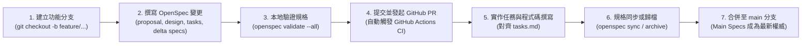

# 🌐 OpenSpec on GitHub: Spec-Driven Development (SDD) 指南

本指南詳細說明如何在 **GitHub** 上落實 **OpenSpec 規格驅動開發（Spec-Driven Development, SDD）**，透過版本控制、Pull Requests (PR)、以及自動化 **GitHub Actions CI**，確保系統架構規格、變更提案與程式實作的 100% 同步與可稽核性。

---

## 🏛️ 一、OpenSpec 在 GitHub 上的核心架構

OpenSpec 將軟體生命週期清晰區分為「**系統當前權威規格（Main Specs）**」與「**單次獨立變更（Changes）**」：

```
myplane/openspec/
├── config.yaml                     # OpenSpec 全域配置（定義 schema 與規範）
├── specs/                          # 🌟 系統當前權威規格庫 (Main Specs on GitHub, 8 項全數收錄)
│   ├── agent-workflow/spec.md      # Agent 工作流與 Evidence Guard 核心規格
│   ├── data-preparation/spec.md   # 資料清洗、去重與衝突隔離規格
│   ├── deterministic-analytics/spec.md # 確定性數值運算與基準規格
│   ├── domain-rules/spec.md        # 環境部 AQI 法定規則與守門規格
│   ├── evaluation-benchmark/spec.md# 60 題評測集與多模式評估規格
│   ├── evidence-retrieval/spec.md  # 測站解析與切片檢索規格
│   ├── github-openspec-integration/spec.md # GitHub Actions CI 自動化驗證規格
│   └── overleaf-draft/spec.md      # Overleaf 論文與 MCP 工具協作規格
└── changes/                        # 🚀 變更管理目錄
    └── archive/                    # 📦 已完成並歸檔之變更歷史
        ├── 2026-11-25-taiwan-aqi-evidence-agent/     # DIC3 核心變更歸檔
        └── 2026-11-25-dic4-overleaf-ieee-conference/ # DIC4 研討會變更歸檔
```

---

## 🔄 二、GitHub 上的 Spec-Driven Development 工作流程

在 GitHub 團隊協作中，每個新功能或論文修訂皆遵循嚴格的 SDD 週期：



### 1. 分支策略（Branching Strategy）
- `main`：僅存放驗證通過之穩定主規格與生產代碼。
- `changes/<change-name>` 或 `feature/<task-name>`：每個 OpenSpec 變更建立專屬分支。例如：
  ```bash
  git checkout -b changes/dic4-overleaf-ieee-conference
  ```

### 2. 撰寫變更計畫 (Proposal, Design, Tasks, Specs)
在 `openspec/changes/<change-name>/` 目錄下建立完整規劃檔案：
- `proposal.md`：變更動機、問題陳述與預期影響。
- `design.md`：架構決策與系統邊界。
- `tasks.md`：可勾選之詳細執行清單（`- [ ]` / `- [x]`）。
- `specs/<capability>/spec.md`：增量規格（`## ADDED Requirements`）。

### 3. 本地檢驗 (Local Validation)
在提交至 GitHub 前，本機先行驗證：
```powershell
cd myplane
openspec validate --all
```
確保通過所有規範驗證（狀態為 `Passed`）。

---

## 🤖 三、GitHub Actions CI 自動化驗證

專案已部署全自動 CI 守護工作流：
檔案路徑：[`.github/workflows/openspec-verify.yml`](file:///c:/Users/user/Downloads/fjdsflds/AIOC-DIC3-ProjectRefactor/.github/workflows/openspec-verify.yml)

### CI 運作機制：
1. **觸發時機**：任何推送到 `main` 分支的提交，或針對包含 `openspec/**` 之 Pull Request。
2. **自動安裝**：CI 容器會自動安裝 Node.js 20 與最新版 `@openspec/cli`。
3. **執行檢查**：自動在 `myplane` 目錄下執行 `openspec validate --all`。
4. **合併門檻（Branch Protection）**：若規格語法錯誤、缺少必填區段或標籤不合規，GitHub Actions 將回報失敗，阻止 PR 合併，確保 GitHub 上的規格永久保持 100% 有效。

---

## 📦 四、規格同步 (Sync) 與歸檔 (Archive) 指南

### 1. 規格同步 (Sync to Main Specs)
當變更正在進行或部分完成，需將 delta specs 同步至主規格庫時：
```powershell
# 將 delta specs 的 ADDED/MODIFIED 合併進 myplane/openspec/specs/
openspec sync --change "dic4-overleaf-ieee-conference"
```

### 2. 變更歸檔 (Archive Change)
當變更任務全數落實且測試通過後，將其歸檔至 `openspec/changes/archive/`：
```powershell
openspec archive --change "taiwan-aqi-evidence-agent"
```
歸檔後，該變更將永久保留於版本歷史中，作為後續專題與評審稽核的完整依據。

---

## 💡 五、常用 OpenSpec 指令速查表

| 指令 | 說明 |
|---|---|
| `openspec list` | 列出專案中所有現有變更與其完成狀態 |
| `openspec status --change "<name>"` | 檢視指定變更之詳細進度與必填產出清單 |
| `openspec validate --specs` | 驗證 `specs/` 下之系統主規格是否符合結構標準 |
| `openspec validate --changes` | 驗證 `changes/` 下各提案與增量規格是否正確 |
| `openspec validate --all` | 全面檢查專案中所有規格、提案與設定檔 |
