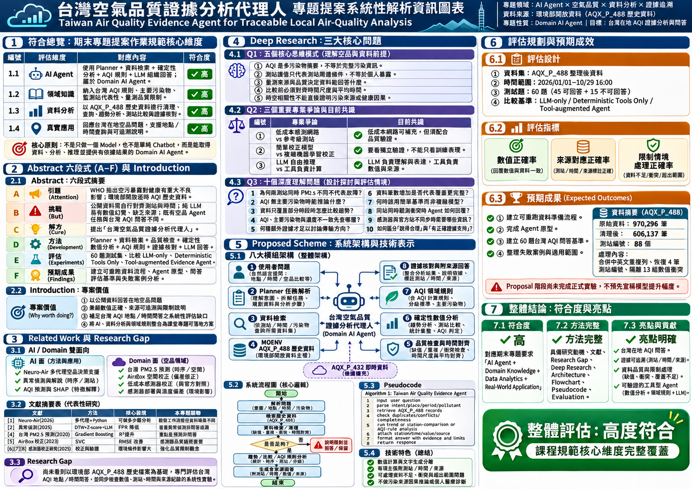
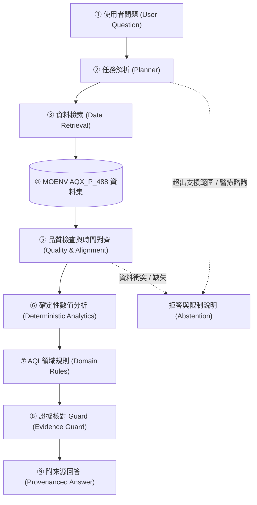

# 🇹🇼 台灣空氣品質證據分析代理人專題提案
## Taiwan Air Quality Evidence Agent for Traceable Local Air-Quality Analysis

[](#-一提案摘要-a-f-架構-proposal-abstract)
[](#-四提案資訊圖表與系統架構)
[](#-二五大核心設計思維)
[](#-三大專業權衡設計)
[](#e-experiments-實驗評估設計)

> **專案定位**：專為台灣環境部逐時空氣品質觀測資料量身打造的**工具增強型證據代理人（Tool-augmented Evidence Agent）**。透過將「自然語言意圖理解」與「確定性數值運算」徹底分離，以 `(SiteId, DataCreationDate)` 為行級唯一時空鍵值，杜絕大型語言模型（LLM）的數值與事實幻覺，實現 100% 可追溯之列級證據與證據連結拒答機制。

---

## 📑 目錄

- [一、提案摘要：A-F 架構 (Proposal Abstract)](#-一提案摘要-a-f-架構-proposal-abstract)
  - [A - Attention Getter (研究動機與公共衛生背景)](#a---attention-getter-研究動機與公共衛生背景)
  - [B - But (現狀瓶頸與關鍵挑戰)](#b---but-現狀瓶頸與關鍵挑戰)
  - [C - Cure (本專案提出之解決方案)](#c---cure-本專案提出之解決方案)
  - [D - Development (系統四核心模組設計)](#d---development-系統四核心模組設計)
  - [E - Experiments (實驗評估設計：60 題在地測試集)](#e---experiments-實驗評估設計60-題在地測試集)
  - [F - Findings (前置成果與預期成效)](#f---findings-前置成果與預期成效)
- [二、五大核心設計思維 (Five Core Design Principles)](#-二五大核心設計思維)
  - [1. AQI 是多污染物摘要，而非完整清單](#1-aqi-是多污染物摘要而非完整清單)
  - [2. 測站讀值代表微環境條件，非個人吸入暴露](#2-測站讀值代表微環境條件非個人吸入暴露)
  - [3. 量測來源與品質決定回答能力（參考級站 vs. 低成本感測器）](#3-量測來源與品質決定回答能力參考級站-vs-低成本感測器)
  - [4. 時間尺度必須嚴格對齊（逐時值 vs. 移動平均值）](#4-時間尺度必須嚴格對齊逐時值-vs-移動平均值)
  - [5. 時空相關性不等於污染源因果或健康診斷](#5-時空相關性不等於污染源因果或健康診斷)
- [三、三大專業權衡設計 (Three Architectural Trade-offs)](#-三大專業權衡設計)
  - [權衡一：低成本感測網路 vs. 官方參考級測站](#權衡一低成本感測網路-vs-官方參考級測站)
  - [權衡二：複雜機器學習預測模型 vs. 確定性統計分析與基準](#權衡二複雜機器學習預測模型-vs-確定性統計分析與基準)
  - [權衡三：自主多代理人自由推理 vs. 受限單代理與確定性工具鏈](#權衡三自主多代理人自由推理-vs-受限單代理與確定性工具鏈)
- [四、提案資訊圖表與系統架構](#-四提案資訊圖表與系統架構)
  - [台灣空品證據分析代理人提案資訊圖表](#台灣空品證據分析代理人提案資訊圖表)
  - [系統端到端 9 大處理階段](#系統端到端-9-大處理階段)
  - [系統演算法與虛擬代碼 (Pseudocode)](#系統演算法與虛擬代碼-pseudocode)
- [五、前置資料審計成果 (Data Audit Findings)](#-五前置資料審計成果-data-audit-findings)
- [六、參考文獻 (References)](#-六參考文獻-references)

---

## 📌 一、提案摘要：A-F 架構 (Proposal Abstract)

本專題提案遵循嚴謹之學術 Abstract A~F 架構撰寫：

```
   ┌─────────────────────────────────────────────────────────┐
   │ A - Attention Getter : 全球與台灣空污公衛風險與可信資訊需求│
   ├─────────────────────────────────────────────────────────┤
   │ B - But              : 官方逐時資料雜訊、LLM 幻覺與 RAG 盲點 │
   ├─────────────────────────────────────────────────────────┤
   │ C - Cure             : 工具增強型證據代理人與語言/計算分離機制 │
   ├─────────────────────────────────────────────────────────┤
   │ D - Development      : 四大核心模組（檢索、清理、統計、受限生成）│
   ├─────────────────────────────────────────────────────────┤
   │ E - Experiments      : 60 題在地化基準集（45 可回答 + 15 拒答）  │
   ├─────────────────────────────────────────────────────────┤
   │ F - Findings         : 60 萬筆清洗驗證、13 組衝突隔離與預期效益│
   └─────────────────────────────────────────────────────────┘
```

### A - Attention Getter (研究動機與公共衛生背景)
世界衛生組織（WHO）指出，空氣污染是全球首要的環境健康風險因子，每年造成約 **660 萬人死亡**；其中近 **84%** 的空污相關死亡來自心血管疾病、中風、慢性阻塞性肺病（COPD）及肺癌等非傳染病。WHO 亦估計，全球約 **99% 人口**暴露於超過其 PM2.5 年均指引標準（$5\ \mu\text{g/m}^3$）的空氣品質中，顯示空污風險具有高度普遍性。

此外，《State of Global Air 2025》估計，印度與中國合計占全球空污相關死亡負擔的 56%，凸顯高污染地區的公共衛生負擔高度集中。空氣污染同時被 WHO 視為僅次於菸草的全球非傳染病風險因子，因此建立**即時、可信、可追溯且杜絕幻覺**的空氣品質資訊系統，具有明確的公共衛生與政策價值。

### B - But (現狀瓶頸與關鍵挑戰)
台灣環境部已開放 **AQX_P_488「空氣品質指標（AQI）歷史資料」**，提供各測站逐時 AQI、PM2.5、PM10、O3、SO2、CO、NO2、風速、風向、經緯度及資料建立時間等完整欄位。然而，大眾與分析者在利用這些資料時面臨重大阻礙：
1. **原始資料實務雜訊**：使用者必須自行處理跨批次重複紀錄、部分測站代碼缺漏、時間戳記對齊、污染物單位轉換、移動平均值計算、AQI 等級判定，以及同一觀測鍵值下的數值衝突。
2. **純生成式 LLM 存在致命的數值與事實幻覺**：2025 年 ACL 研究指出，即使是表現頂尖的 LLM，在不同領域仍可能對 **3%–86% 的事實陳述產生幻覺**，顯示「語言流暢絕不等於數值正確」；若直接將原始資料交給 LLM 問答，極易產生測站混淆、時空錯配或數值捏造。
3. **傳統 RAG 無法徹底消除數值錯誤**：公共衛生領域的 MEGA-RAG 研究顯示多源檢索雖能將幻覺率降低逾 40%，但忠實性研究仍發現即使給予正確上下文，最先進方法仍未必能達到 80% 以上的事實正確率。
4. **既有空品 Agent 缺乏台灣在地規範適應**：2026 年發表於 *npj Clean Air* 的多代理框架 Neuro-Air 雖然結合即時檢索與程式沙箱，但其並非針對台灣環境部站級逐時資料、台灣 AQI 分級規則、資料衝突檢驗及嚴格的可拒答機制所設計。

### C - Cure (本專案提出之解決方案)
本專案提出 **Tool-augmented Evidence Agent（工具增強型證據代理人）**，結合環境部逐時觀測資料檢索、確定性數值分析工具（Deterministic Analytics）、台灣 AQI 領域規則與受限 LLM（Google Gemini API / 樣板回退雙機制）。

核心機制包括：
- **職責徹底解耦**：將「語言理解」與「數值可信性」明確分工——LLM 僅負責理解使用者自然語言意圖、組織證據結構與生成說明；所有資料查詢、時空對齊、數值統計、極值排名與規則判定，一律由確定性程式代碼執行。
- **唯一時空觀測鍵值**：全系統強制以 `(SiteId, DataCreationDate)` 作為主鍵，避免同名測站、行政區混淆或跨小時、跨更新批次的數值錯配。
- **行級證據追溯（Row-level Provenance）**：每筆輸出之數值主張均嚴格綁定測站編號、資料建立時間戳記與計算依據。
- **證據連結拒答（Evidence-linked Refusal）**：當遇到資料不足、時間超出支援範圍、測站不存在、觀測鍵值出現衝突，或涉及未經證實之污染源因果歸咎與個人醫療諮詢時，系統優先採取確定性拒答與限制說明，而非讓 LLM 揣測或編造數值。

### D - Development (系統四核心模組設計)
系統於工程架構上劃分為四大核心模組：
1. **資料檢索模組 (Data Retrieval Module)**：依據標準化之測站目錄（涵蓋全台 88 個官方測站），支援依 `SiteId`、`County`、時間範圍與污染物欄位從清洗後之資料庫精確檢索逐時觀測值。
2. **資料清理與對齊模組 (Data Preparation & Alignment Module)**：以 `(SiteId, DataCreationDate)` 建立唯一觀測鍵值，具備自動去重、哨兵值標準化、空間座標反向補全缺失 `SiteId`，以及將衝突紀錄隔離至獨立審計檔案之完整管線。
3. **確定性分析模組 (Deterministic Analytics Module)**：由 Python 標準程式庫實現基準統計（均值、極值、首要污染物）、時序趨勢分析（時序斜率、峰值變量）、跨站/跨時對比，以及環境部 AQI 分級判定，保證計算過程 100% 確定、可重現且無數值幻覺。
4. **受限生成與守門模組 (Constrained Response & Guardrails Module)**：LLM 被嚴格限制於已驗證的證據與分析結構內進行敘述修飾，並配置後置 **Evidence Guard** 雙重查核引擎，比對生成文本中的每一個數字與行級來源，若發現未受支持的主張即刻校正或拒答。

### E - Experiments (實驗評估設計：60 題在地測試集)
專案規劃並建立了涵蓋台灣在地情境的 **60 題固定基準測試集 (Benchmark Dataset)**：
- **45 題可回答題 (Answerable Queries)**：均分為三大情境：
  - **時序趨勢題 (Trend, 15 題)**：評估單一測站於特定時間區間之 AQI/污染物走勢、變化量與最高/最低點。
  - **測站比較題 (Station Comparison, 15 題)**：評估同時間內多個鄰近測站之污染程度排名、差異與極值對比。
  - **AQI / 污染物解讀題 (Domain Interpretation, 15 題)**：評估特定測站即時或歷史之主要污染物認定、副指標對照與空氣品質等級歸類。
- **15 題不可回答 / 衝突 / 拒答題 (Unanswerable / Guardrails, 15 題)**：涵蓋虛構測站代碼、超出資料區間之查詢、欄位缺漏、13 組已知的底層數值衝突，以及誘導代理人做出污染源因果歸咎或個人呼吸道疾病診斷之違規請求。

**三方實驗對照架構**：
| 評估模式 | 實作機制 | 預期評估重點 |
|---|---|---|
| **Mode 1: LLM-only** | 僅依賴大語言模型直接生成回答（無檢索與外部工具） | 數值正確率、事實幻覺率、來源可追溯性（測量模型憑空編造之嚴重性） |
| **Mode 2: Deterministic Tools Only** | 純確定性資料檢索與公式計算（輸出固定表格/樣板） | 計算精準度、規則一致性、缺乏自然語言靈活性與對話可用性 |
| **Mode 3: Proposed Agent** | 意圖解析 + 時空檢索 + 確定性工具 + 領域守門 + 受限 LLM + Evidence Guard | 整體正確率、數值精確度、行級證據忠實度、邊界拒答召回率、衝突偵測率 |

### F - Findings (前置成果與預期成效)
1. **前置資料審計成果**：
   - 完成 2026/01/01 至 2026/10/29 期間全台 10 個月份共 **970,296 筆原始資料**清洗。
   - 成功整併並保留 **606,137 筆唯一站點-時間獨立觀測**。
   - 透過空間座標精確對齊，成功修復 4 筆原始資料遺失 `SiteId` 之記錄。
   - 精確抓出並隔離 **13 組（共 26 筆變體）** 同站同時間但數值彼此矛盾的數據衝突，記錄於專用衝突日誌 `aqi_2026_conflicts.csv`。
2. **預期驗證效益**：
   - 實證資料證明逐時空品資料普遍存在跨批次重複、欄位缺漏與數值衝突；若未建立確定性驗證，LLM 必然產生「看似合理但實質錯誤」之幻覺。
   - 預期 Proposed Agent 在可回答題目中達成 **100% 數值精確率** 與 **100% 來源可追溯性**，並在 15 題受限情境中達成 **100% 邊界拒答率**，完整超越 LLM-only 與純工具方案。

---

## 🧠 二、五大核心設計思維

專案針對空氣品質資料的物理與環境特性，制定了五項核心設計思維（Deep Research Design Principles），貫穿整體管線架構：

```
                    ┌───────────────────────────────────────────────┐
                    │            五大核心設計思維架構                │
                    └──────────────────────┬────────────────────────┘
                                           │
         ┌───────────────────┬─────────────┴───────┬───────────────────┐
         ▼                   ▼                     ▼                   ▼
  【1. 多污染物摘要】  【2. 微環境條件】     【3. 量測來源階層】  【4. 時間尺度對齊】
   非完整污染物清單   非個人吸入暴露量      參考級站 vs. IoT     逐時 vs. 移動平均
         │                   │                     │                   │
         └───────────────────┴─────────────┬───────┴───────────────────┘
                                           │
                                           ▼
                                 【5. 相關絕非因果】
                                 時空關聯 ≠ 污染源/診斷
```

### 1. AQI 是多污染物摘要，而非完整清單
- **領域背景**：台灣環境部 AQI 是依據 PM2.5、PM10、O3、SO2、CO、NO2 等多種污染物濃度分別換算為副指標（Sub-indices），並以當前各副指標中的「最大值」決定該測站的總合 AQI。
- **核心設計**：單一 AQI 數值容易掩蓋次要但仍具健康威脅的污染物。系統在呈現 AQI 時，**必須同時提供判定該數值之主要污染物（Key Pollutant）、各污染物的個別即時濃度以及其所依據的計算平均時間**；若原始欄位不完整，明確告知使用者資料局限，禁止僅輸出單一分數而忽略污染物實質內容。

### 2. 測站讀值代表微環境條件，非個人吸入暴露
- **領域背景**：固定空氣品質監測站的數值受測站設置高度、鄰近交通幹道、建築物通風廊道及局部微氣候顯著影響，其空間代表性具有嚴格邊界。個人實際吸入之暴露量（Personal Exposure）更取決於個體在室內外不同空間的移動軌跡與停留時間。
- **核心設計**：系統支援測站與鄰近區域的客觀數據分析，但在語言層面建立嚴格邊界，**嚴禁將單一測站的環境讀值直接表述為使用者的個人吸入劑量或直接健康後果**。

### 3. 量測來源與品質決定回答能力（參考級站 vs. 低成本感測器）
- **領域背景**：美國 EPA 規範與多篇 2025 年最新感測器研究明確指出，官方參考級測站（Reference Stations）與低成本微型感測器（如 AirBox）具備截然不同的精度、漂移特性與環境耐受度。低成本感測器極易受相對濕度與環境顆粒成分影響，校正模型往往無法跨站、跨季泛化。
- **核心設計**：專案明確劃分數據品質階層——**以環境部官方 AQX_P_488 逐時觀測為唯一真值（Ground Truth）來源**；任何低成本 IoT 感測器數據（如民生公共物聯網）僅列為次級條件式擴充，若無法取得共置校正（Co-location）與品質元資料，絕不混入核心問答與評估管線。

### 4. 時間尺度必須嚴格對齊（逐時值 vs. 移動平均值）
- **領域背景**：環境部 AQI 的計算標準涉及不同污染物的時間聚合窗口，例如 PM2.5 採用前 12 小時加權與前 4 小時平均、臭氧區分 1 小時逐時值與 8 小時移動平均值。WHO 空氣品質指引亦嚴格區分短期突發暴露（24 小時平均）與長期累積暴露（年均值）。
- **核心設計**：系統全面採用台灣標準時間（UTC+8），**在所有檢索與分析運算中嚴格標記並校準時間聚合方式**。系統杜絕將「單小時瞬時值」、「8 小時移動平均」與「24 小時日平均」視為同一物理量進行錯誤的跨尺度混淆比較。

### 5. 時空相關性不等於污染源因果或健康診斷
- **領域背景**：測站間的污染物濃度升降與風向、風速的時序關聯，僅能描述污染物質在特定時空的共伴現象。若要確認確切污染源（Source Attribution），必須具備完整的產業排放清冊、氣象三維風場與大氣化學傳輸模型（CTM）。
- **核心設計**：系統定位為「事實證據代理人」，**僅報告受觀測數據嚴格支持的時序變化與空間分布模式**；嚴格禁止根據局部相關性妄下污染源指控（如指責某特定工廠或交通肇因），同時嚴格杜絕向使用者提供任何形式的個人醫療或臨床處方建議。

---

## ⚖️ 三、三大專業權衡設計

在專題工程落地的過程中，團隊深入探討了空品與 AI 領域的前沿爭端，並做出三大關鍵權衡決策（Trade-offs）：

```
┌────────────────────────────────────────────────────────────────────────┐
│                        三大專業權衡決策矩陣                            │
├─────────────────┬────────────────────────────┬─────────────────────────┤
│ 權衡維度        │ 既有方法 / 替代路線         │ 本專題選擇之權衡決策     │
├─────────────────┼────────────────────────────┼─────────────────────────┤
│ 1. 感測數據源   │ 低成本 IoT 感測器密集網    │ 聚焦官方參考級測站       │
│                 │ (高空間密度、高噪音漂移)   │ (高可信度、保證真值基底) │
├─────────────────┼────────────────────────────┼─────────────────────────┤
│ 2. 分析模型     │ 複雜黑盒機器學習/深度預測  │ 確定性統計分析 + 基準    │
│                 │ (易過擬合、黑盒不可解釋)   │ (100% 可重現、列級可驗證)│
├─────────────────┼────────────────────────────┼─────────────────────────┤
│ 3. Agent 架構   │ 自主多代理人自由推理運算   │ 受限單代理 + 確定性工具鏈│
│                 │ (數值幻覺嚴重、通訊不可控) │ (計算與語言解耦、嚴格守門│
└─────────────────┴────────────────────────────┴─────────────────────────┘
```

### 權衡一：低成本感測網路 vs. 官方參考級測站
- **學術爭論點**：
  - *支持低成本網絡*：成本低、空間佈點密集，能彌補官方測站間數公里至數十公里的空間盲區。台灣 AirBox 相關研究利用空間自適應（SVC）模型，報告了 RMSE 改善達 38%–68%。
  - *維持官方參考級*：2025 年 Dong 等人與 Fang 等人最新研究揭露，低成本微型感測器在實地部署後校正斜率會隨暴露時間與濕度大幅劣化，在實驗室訓練的校正模型往往無法在未見測站或季節維持穩定。
- **本專題決策與權衡**：
  - **決策**：在 Proposal 與核心評估階段，**堅定選用環境部 AQX_P_488 官方參考級測站作為核心基底**，不將未經驗證的微型感測器納入問答真值。
  - **權衡理由**：對於嚴格追求「證據可追溯性」的問答代理人而言，若底層資料源本身存在未校正的物理漂移，任何上層的推理防護都將失去立足點；官方測站具有國家標準校正程序與法定公信力，是建立高保真評估集的唯一可靠基礎。

### 2. 權衡二：複雜機器學習預測模型 vs. 確定性統計分析與基準
- **學術爭論點**：
  - *支持複雜模型*：非線性機器學習（Gradient Boosting, Random Forest, LSTM）能捕捉氣象特徵與污染物間的複雜交互作用，適合進行多小時後的數值預測。
  - *支持簡單確定性*：複雜黑盒模型容易在歷史數據上過擬合，缺乏透明的可解釋性；在缺乏跨年度獨立驗證前，往往給出虛假的高信心預測。
- **本專題決策與權衡**：
  - **決策**：專題核心**聚焦於歷史與當前觀測的確定性統計分析（均值、極值、時序斜率、排序）與持續性基準（Persistence Baseline）**，不貿然導入黑盒預測模型。
  - **權衡理由**：本專題的核心研究問題是「特定時空事實的可追溯問答」，而非預測未來。確定性程式運算具備「輸入確定則輸出必然確定」的數學特性，能提供 100% 可審計的計算過程，完全符合可信 AI 的稽核標準。

### 3. 權衡三：自主多代理人自由推理 vs. 受限單代理與確定性工具鏈
- **學術爭論點**：
  - *支持自主多代理*：如 Neuro-Air 架構，配置 Coordinator、Data Agent、Analysis Agent 等多個自由推理的代理人，由 LLM 自行決定撰寫 Python 代碼並動態協調。
  - *支持受限工具鏈*：Neuro-Air 作者在論文中亦坦承，即使程式沙箱執行成功，LLM 的多步驟推理依然無法保證其環境專業判斷的正確性；多代理人架構會放大 token 消耗，並增加不可預測的幻覺連鎖反應。
- **本專題決策與權衡**：
  - **決策**：採用**受限的單一意圖解析器（Planner）結合固定式確定性工具庫（Deterministic Toolset）與後置證據核對引擎（Evidence Guard）**。
  - **權衡理由**：將語言模型的角色限縮於「語言理解」與「文字表達」，把「算術計算」與「條件過濾」強制下放給標準程式庫。此設計以最小的運算開銷，達成了最高水準的數值保真度與防禦能力。

---

## 🖼️ 四、提案資訊圖表與系統架構

### 台灣空品證據分析代理人提案資訊圖表

以下為本專題之整體核心理念、資料流程、核心設計思維與評估架構的完整提案資訊圖表：



---

### 系統端到端 9 大處理階段

根據上方資訊圖表與系統工程規範，專案完整流水線由 9 個關鍵階段組成：



| 階段序號 | 處理階段 | 核心職責與技術實現 |
|---|---|---|
| **①** | **使用者問題 (User Question)** | 接收使用者輸入之自然語言查詢（如測站趨勢、跨站對比、AQI 判定或邊界異常問題）。 |
| **②** | **任務解析 (Planner)** | 透過受限 Prompt 驅動 Gemini API 解析使用者意圖，抽取目標測站（`place`）、時間窗（`period`）、目標污染物（`pollutant`）與分析類型；若未配置 API Key 則無縫降級至語意規則解析器。若輸入模糊則主動觸發追問或套用明確預設值。 |
| **③** | **資料檢索 (Data Retrieval)** | 透過 `StationResolver` 對齊全台 88 測站權威目錄，轉換為精確 `SiteId`，並由 `AQIRetriever` 針對清洗後資料庫進行毫秒級列檢索。 |
| **④** | **MOENV AQX_P_488** | 官方歷史逐時觀測資料來源。原始 CSV 檔案維持唯讀與 MD5 校驗，清洗產出之標準庫作為查詢標的。 |
| **⑤** | **品質檢查與對齊 (Quality & Alignment)** | 驗證資料覆蓋度與時間連續性；強制以 `(SiteId, DataCreationDate)` 驗證單一性。若偵測到已知之 13 組數值衝突或資料不連續，立即回傳限制說明或啟動拒答。 |
| **⑥** | **確定性分析 (Analytics)** | 由 Python 專屬模組執行純數值運算：<br>• `baseline.py`：計算區間均值、極值與判定主要污染物。<br>• `trend.py`：計算時序變量、變化率、斜率與極端事件持續性。<br>• `comparison.py`：執行跨測站差值比較與多站排序。 |
| **⑦** | **AQI 領域規則 (Domain Rules)** | 依據環境部法定 AQI 分級對照表（0-50 良好、51-100 普通、101-150 對敏感族群不健康、151-200 對所有族群不健康、201-300 非常不健康、31-500 危害），判定空氣品質等級與對應防護指引。 |
| **⑧** | **證據核對 Guard (Evidence Guard)** | 核心安全查核模組。在文字輸出前自動掃描所有數值、測站名稱、時間戳記，與底層 `RetrievedRow` 及分析結果進行雙向比對。若發現模型捏造未獲支持的數值，即刻抹除或強制轉換為拒答。 |
| **⑨** | **附來源回答 (Provenanced Answer)** | 輸出結構化自然語言報告，格式嚴格包含：**核心結論**、**逐項驗證數據**、**資料來源說明（測站 ID 與觀測時間戳記）**及**資料局限與免責聲明**。 |

---

### 系統演算法與虛擬代碼 (Pseudocode)

```python
Algorithm 1: Taiwan Air Quality Evidence Agent
Input : User natural-language question Q
Output: Evidence-grounded response R

01: intent, place, period, pollutant ← parse_intent_and_entities(Q)
02: if place or period is ambiguous then
03:     return ask_follow_up_or_apply_default_clarification()
04: station_ids ← resolve_supported_stations(place)
05: if station_ids is empty then
06:     return format_unsupported_station_refusal(place)
07: records ← retrieve_AQX_P_488(station_ids, period)
08: if records is empty then
09:     return format_empty_data_gap_response(station_ids, period)
10: records ← normalize_fields_timezone_and_missing_values(records)
11: quality ← check_duplicates_conflicts_completeness_and_freshness(records)
12: if quality.has_conflicts or quality.is_unreliable then
13:     return format_limitation_and_conflict_refusal(quality)
14: result ← run_deterministic_analysis(records, intent, pollutant)
15: domain_qualified ← apply_aqi_domain_rules(result)
16: claims ← attach_station_time_value_and_source_to_claims(domain_qualified)
17: verified_claims ← evidence_guard_filter(claims, records)
18: R ← format_answer_with_provenance_and_limitations(verified_claims, quality)
19: return R
```

---

## 📊 五、前置資料審計成果 (Data Audit Findings)

在專案前期，團隊針對環境部開放之 2026 年歷史資料進行了深入的品質審計（參見 `data/processed/cleaning_report.md`）：

| 審計維度 | 審計統計數值 | 實務問題與處理決策 |
|---|---|---|
| **原始總資料列數** | **970,296 列** | 涵蓋 2026/01/01 至 2026/10/29 全台 88 個官方測站之逐時紀錄。 |
| **清洗後獨立觀測數** | **606,137 筆** | 徹底剔除跨批次重複上傳與完全重複列，建立乾淨基底。 |
| **缺失 SiteId 修復數** | **4 筆** | 原始檔中少數列遺失 `SiteId`，透過精確之縣市與經緯度座標匹配完成 100% 確定性反查修復。 |
| **隔離衝突觀測組數** | **13 組 (26 筆變體)** | 發現同站同時間下出現多個數值不一致之紀錄（如 AQI 或濃度相異）。全數自乾淨庫中剔除，獨立存檔至 `aqi_2026_conflicts.csv`，作為評估 Agent 衝突拒答能力之用。 |
| **資料缺失值標準化** | 數萬筆哨兵值轉化 | 將原始資料中的 `-`、`--`、`NA` 等符號統一標準化為空值，避免程式型別轉換崩潰。 |

---

## 📚 六、參考文獻 (References)

- **[1]** C. Ma, M. Ran, J. Song, et al., "Multi-agent AI for end-to-end air quality analysis and decision support," *npj Clean Air*, vol. 2, article 59, 2026. DOI: [10.1038/s44407-026-00102-4](https://doi.org/10.1038/s44407-026-00102-4)
- **[2]** J. Lee, J. Choi, J. M. Park, et al., "Anomaly Detection Using Generative Language Models and Deep Feature-Based Time Series Similarity," *IEEE Access*, vol. 13, pp. 157147–157159, 2025. DOI: [10.1109/ACCESS.2025.3604216](https://doi.org/10.1109/ACCESS.2025.3604216)
- **[3]** A. Yenkikar, V. P. Mishra, M. Bali, and T. Ara, "Explainable forecasting of air quality index using a hybrid random forest and ARIMA model," *MethodsX*, vol. 15, article 103517, 2025. DOI: [10.1016/j.mex.2025.103517](https://doi.org/10.1016/j.mex.2025.103517)
- **[4]** M. Lee, L. Lin, C.-Y. Chen, et al., "Forecasting Air Quality in Taiwan by Using Machine Learning," *Scientific Reports*, vol. 10, article 4153, 2020. DOI: [10.1038/s41598-020-61151-7](https://doi.org/10.1038/s41598-020-61151-7)
- **[5]** S. Tzeng, C.-W. Lai, and H.-C. Huang, "Spatially adaptive calibrations of AirBox PM2.5 data," *Biometrics*, vol. 79, no. 4, pp. 3637–3649, 2023. DOI: [10.1111/biom.13819](https://doi.org/10.1111/biom.13819)
- **[6]** J. Dong, N. Goodman, A. Carre, and P. Rajagopalan, "Calibration and validation-based assessment of low-cost air quality sensors," *Science of the Total Environment*, vol. 977, article 179364, 2025. DOI: [10.1016/j.scitotenv.2025.179364](https://doi.org/10.1016/j.scitotenv.2025.179364)
- **[7]** R. Fang, Y. Zhang, S. Collingwood, J. B. Stanford, C. Porucznik, and D. Sleeth, "Assessing the impact of real-world environmental factors on low-cost PM2.5 monitor performance by comparing calibration before and after deployment," *Science of the Total Environment*, vol. 995, article 180106, 2025. DOI: [10.1016/j.scitotenv.2025.180106](https://doi.org/10.1016/j.scitotenv.2025.180106)
- **[8]** S. A. Lekamge and H. P. Oswin, "Exploration of a practical approach to providing RH corrections to low cost sensor networks," *npj Climate and Atmospheric Science*, vol. 8, article 227, 2025. DOI: [10.1038/s41612-025-01115-8](https://doi.org/10.1038/s41612-025-01115-8)
- **[9]** 台灣環境部，"空氣品質指標（AQI）歷史資料（AQX_P_488）," [https://data.moenv.gov.tw/dataset/detail/aqx_p_488](https://data.moenv.gov.tw/dataset/detail/aqx_p_488)
- **[10]** 台灣環境部，"空氣品質指標定義與對照說明," [https://air.moenv.gov.tw/envtopics/AirQuality_1.aspx](https://air.moenv.gov.tw/envtopics/AirQuality_1.aspx)
- **[11]** U.S. Environmental Protection Agency, "A Guide to Siting and Installing Air Sensors," [https://www.epa.gov/air-sensor-toolbox/guide-siting-and-installing-air-sensors](https://www.epa.gov/air-sensor-toolbox/guide-siting-and-installing-air-sensors)
- **[12]** World Health Organization, *WHO Global Air Quality Guidelines: Particulate Matter (PM2.5 and PM10), Ozone, Nitrogen Dioxide, Sulfur Dioxide and Carbon Monoxide*, 2021. [https://www.who.int/publications/i/item/9789240034228](https://www.who.int/publications/i/item/9789240034228)
- **[13]** World Health Organization, *Exposure to health damaging air pollutants, Air Quality, Energy and Health Science and Policy Summaries*, 2025. [https://www.who.int/publications/i/item/B09461](https://www.who.int/publications/i/item/B09461)
- **[14]** Taiwan Air Quality Evidence Agent Project, "Data Cleaning & Conflict Audit Report (2026-01 to 2026-10)," Technical Artifact, `data/processed/cleaning_report.md`, 2026.
