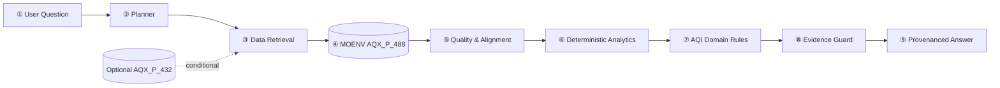

## Context

### 提案摘要解析 (Abstract: A-F Structure)

#### Attention Getter（Motivation）
世界衛生組織（WHO）指出，空氣污染是全球首要的環境健康風險因子，每年造成約 660 萬人死亡；其中近 84% 的空污相關死亡來自心血管疾病、中風、慢性阻塞性肺病（COPD）及肺癌等非傳染病。 WHO 亦估計，全球約 99% 人口暴露於超過其 PM2.5 年均 guideline（5 μg/m³）的空氣品質，顯示空污風險具有高度普遍性。

此外，State of Global Air 2025 估計，印度與中國合計占全球空污相關死亡負擔的 56%，凸顯高污染地區的公共衛生負擔高度集中。 空氣污染同時被 WHO 視為僅次於菸草的全球非傳染病風險因子，因此建立即時、可信、可追溯的空氣品質資訊系統，具有明確的公共衛生與政策價值。

#### But（Challenge）
環境部已開放 AQX_P_488「空氣品質指標（AQI）歷史資料」，提供各測站逐時 AQI、PM2.5、PM10、O3、SO2、CO、NO2、風速、風向、經緯度及資料建立時間等欄位。 然而，使用者仍須自行處理測站對齊、時間戳記、污染物單位、移動平均值、AQI 等級判定及資料缺漏等問題；若直接將原始資料交由生成式 LLM 回答，容易產生站點、時間或數值錯配。

純生成式 LLM 也存在明顯的數值與事實幻覺風險。2025 年 ACL 研究指出，即使是表現較佳的 LLM，在不同領域仍可能對 3%–86% 的事實陳述產生幻覺，顯示語言流暢並不等於數值正確。 雖然 Retrieval-Augmented Generation（RAG）可降低幻覺，但研究顯示其並無法完全消除錯誤：一項公共衛生領域的 MEGA-RAG 研究透過多源檢索、重排序與證據不一致檢查，將幻覺率降低逾 40%；另一項 RAG 忠實性研究則發現，即使提供正確上下文，最先進方法仍未必能達到 80% 以上的事實正確率。

既有空品 Agent 亦尚未完全解決台灣在地需求。Neuro-Air 是 2026 年發表於 npj Clean Air 的多代理 LLM 框架，結合即時空污資料檢索與持久化程式執行沙箱，並透過協調代理調度多個領域代理處理都市空污管理任務。 不過，其資料範圍、任務設計與評估情境並非針對台灣環境部站級逐時資料、台灣 AQI 規則、資料衝突偵測及可拒答機制而設計。

#### Cure（Proposed Solution）
本研究提出一個 Tool-augmented Evidence Agent，結合環境部逐時觀測資料檢索、確定性數值分析工具（Deterministic Analytics）、台灣 AQI 領域規則與受限 LLM。系統將語言理解、資料檢索、數值計算與規則判定明確分工：LLM 負責理解使用者意圖、組織證據與生成說明；確定性工具負責查詢、對齊、計算、比較與規則判定。

具體而言，系統以 (SiteId, DataCreationDate) 作為唯一觀測鍵值，避免同名測站、行政區混淆或跨小時、跨更新批次的數值錯配。 當使用者詢問某測站於特定時間的 AQI、主要污染物、濃度變化或空品等級時，Agent 必須先檢索對應原始觀測，再由確定性工具完成計算與規則判斷，最後才由 LLM 產生附帶來源、時間、測站與計算依據的回答。

若資料不足、時間範圍不支援、測站不存在，或同一觀測鍵值下出現數值衝突，系統將優先採取證據連結的拒答（evidence-linked refusal），而非讓 LLM 自行推測或補完數值。此設計直接回應 LLM 在高風險、數值敏感任務中的幻覺問題。

#### Development（Method）
本研究將系統拆分為四個模組：
- **資料檢索模組**：從環境部 AQX_P_488 逐時資料集中，依 SiteId、County、時間範圍與污染物欄位檢索觀測值。
- **資料清理與對齊模組**：以 (SiteId, DataCreationDate) 建立唯一觀測鍵值，處理重複紀錄、缺值、單位、時間戳記與跨批次更新問題。
- **確定性分析模組**：執行 AQI 等級判定、污染物比較、時序變化、移動平均、極值查詢及異常偵測；所有數值結果均由程式計算，而非由 LLM 直接生成。
- **受限生成模組**：LLM 僅能根據已驗證的證據與工具輸出撰寫回答，並須標註測站、時間、資料來源、計算依據；無法驗證時必須明確拒答。

此架構的創新之處，在於不是僅將 LLM 與 RAG 結合，而是將「語言理解」與「數值可信性」徹底分離，並以台灣 AQI 規則作為領域約束。

#### Experiments（Evaluation）
本研究規劃建立 60 題台灣在地空品測試集，包含：
- **45 題可回答題**：涵蓋單一測站即時或歷史 AQI、主要污染物、濃度變化、跨日比較、區域概況及 AQI 等級判定。
- **15 題資料不足／衝突／拒答題**：涵蓋測站不存在、時間超出資料範圍、欄位缺漏、同一觀測鍵值數值衝突，以及無法由既有規則安全推論的問題。

實驗將比較三種模式：
- **LLM-only**：僅使用 LLM 直接回答（評估重點：數值正確率、幻覺率、來源可追溯性）
- **Deterministic Tools Only**：僅使用確定性工具與規則（評估重點：計算正確性、規則一致性、自然語言可用性）
- **Proposed Agent**：檢索 + 確定性工具 + 台灣 AQI 規則 + 受限 LLM（評估重點：整體正確率、拒答正確性、證據可追溯性、衝突偵測）

評估指標將包括回答正確率、數值正確率、AQI 等級判定正確率、來源引用正確率、拒答正確率，以及資料衝突偵測率。此設計可檢驗系統是否不僅「能回答」，更能判斷「何時不應回答」。

#### Findings（Expected Outcomes）
目前 Proposal 階段尚未進行 Agent 實驗，因此所有成效均標註為待驗證。現階段已完成 2026/1/1 至 2026/10/29 共 970,296 筆原始資料清理，保留 606,137 筆獨立觀測，並隔離 13 組數值衝突。

這些前置成果顯示，台灣逐時空品資料確實存在重複、缺漏、時間對齊與數值不一致等實務問題；若未建立確定性驗證與拒答機制，LLM 可能將不完整或衝突資料轉化為看似合理但錯誤的回答。本研究預期，相較於 LLM-only 與 Deterministic Tools Only，本 Agent 能在維持可用性的同時，提高數值正確性、來源可追溯性與拒答可靠性。

使用者在查詢與解讀台灣空氣品質（AQI）及特定污染物變化時，面臨公開資料查詢分散、時序資料對齊困難、缺值與衝突未標註等痛點。現有生成式 AI 模型雖能產出流暢文字，但容易產生數值幻覺、缺乏原始資料出處追溯，且無法嚴格遵守台灣環境部（MOENV）之 AQI 計算規則（包含各污染物副指標最大值、不同污染物移動平均時窗差異等）。

本專題以環境部歷史觀測資料集 **AQX_P_488** 為核心，時間範圍為 2026-01-01 00:00 至 2026-10-29 16:00（共 970,296 筆原始紀錄，經可重現清洗後保留 606,137 筆有效觀測、88 個測站編號，隔離 13 組數值衝突）。系統旨在建構一個「語言理解與數值計算分離」的工具增強型證據代理人（Taiwan Air Quality Evidence Agent），確保所有數值主張均由確定性工具產出並回溯至原始觀測列。

## Goals / Non-Goals

**Goals:**
- **數值可追溯性**：回答中所有 AQI、污染物濃度、趨勢變化量與排名，均直接繫結至來源測站編號、時間戳記與資料紀錄鍵值。
- **計算確定性與防幻覺**：所有數學運算、聚合、排序與領域規則檢查均由純程式碼工具執行，嚴禁 LLM 自行推算或插值數值。
- **資料品質與限制透明度**：顯式處理並揭露資料缺失、時段不完整、中英文重複與數值衝突，在資料不足時明確拒答或給出限制說明。
- **嚴格守護領域邊界**：遵循環境部副指標最大值與平均時間規範，嚴格拒絕提供個人化醫療診斷與單點風向之未驗證污染源因果推論。
- **可重現之三基準評估**：建立 60 題台灣在地空品基準集，量化評估 LLM-only、Deterministic Tools 與 Tool-augmented Agent 之表現。

**Non-Goals:**
- **非通用多代理架構**：不宣稱提出通用 Multi-Agent 演算法或複雜多代理協商拓撲。
- **非機器學習空氣品質預測**：MVP 不包含深度學習或時間序列模型預測未來空品。
- **非個人暴露量評估**：固定測站讀值僅代表周遭監測環境，不作為個人吸入暴露量推估。
- **非污染源因果歸因**：不以時空相關或風向直接斷定特定排放源之法律或科學因果責任。
- **非即時 IoT 融合（MVP 階段）**：民生公共物聯網（如 AirBox）與即時 API（AQX_P_432）僅列為條件式擴充，不作為核心驗證前提。

## Decisions

### 1. 語言模型與數值計算徹底分離 (Separation of Semantic Understanding and Deterministic Computation)
- **決策**：LLM 僅負責將使用者自然語言問題解析為結構化查詢參數（Planner），以及將通過驗證的計算結果轉化為易讀之自然語言總結。所有資料檢索、過濾、統計計算、排序與規則判定，均由本機確定性 Python 程式碼執行。
- **考量理由**：避免 LLM 的數值幻覺與偽造引用，確保相同資料與問題在任何時候均產出完全一致的數值結果，便於自動化稽核與驗證。
- **替代方案**：端到端自由推理 LLM（如僅透過 Prompt 注入原始資料），已被既有研究證實容易在時序計算與數值極值比對中出錯。

### 2. 觀測主鍵與衝突隔離機制 (Observation Key and Conflict Isolation Policy)
- **決策**：採用 `(SiteId, DataCreationDate)` 作為唯一觀測鍵值，嚴禁以測站名稱單獨作為 Join 依據。若同鍵值之重複列數值完全一致則安全合併；若任一非空數值欄位衝突，則將所有變體全數排除於乾淨資料集外，並存入 `aqi_2026_conflicts.csv` 供稽核。
- **考量理由**：原始資料中包含中英文重複上傳與少數衝突變體，直接覆寫或隨機選取任一版本會損害研究嚴謹性；全數隔離並記錄是資料可信度與重現性的最高準則。
- **替代方案**：後進先出（LIFO）覆寫或欄位平均法，這些做法會掩蓋原始資料不一致性，造成不可追溯的誤差。

### 3. 空間幾何輔助測站編號修復 (Deterministic Spatial SiteId Recovery)
- **決策**：僅當縣市名稱與精確座標 `(TWD97Lon, TWD97Lat)` 在已知測站對照表中唯一映射至單一 `SiteId` 時，方補全缺失的測站編號（已驗證成功修復 4 筆）；若有歧義則維持不補全並記入衝突紀錄。
- **考量理由**：保證補全過程百分之百確定性，不引入推論假設。

### 4. 雙重護欄與證據守門機制 (Evidence Guard Architecture)
- **決策**：在輸出生成階段引入 Evidence Guard 檢驗層，將輸出文字中的數值與實體提取出來，與檢索結果進行反向校驗。若發現輸出包含未獲原始資料支持之數值，立即剔除或修正該主張。
- **考量理由**：形成封閉驗證迴圈（Closed-loop Verification），確保端到端輸出的證據忠實度（Provenance Fidelity）達到最高標準。

### 5. 系統架構管線 (9-Stage Pipeline)

## Risks / Trade-offs

- **[風險 1：資料時間範圍非完整年度]**  
  *影響*：當前下載資料僅涵蓋 2026/01/01 至 2026/10/29，無法支援完整年度或跨季長期分析。  
  *緩解措施*：系統於查詢跨越缺失範圍時顯式回傳時間邊界限制，不宣稱完整年度結論。
- **[風險 2：DataCreationDate 時間語意未確認]**  
  *影響*：無法判定為物理採樣時間、儀器上傳時間或系統發布時間。  
  *緩解措施*：欄位統一保留為原始名稱 `DataCreationDate`，不直接更名為 `observed_at`，並在輸出中如實標註來源時間戳記。
- **[風險 3：非官方微型感測器品質差異]**  
  *影響*：IoT 感測器受溫濕度與漂移影響極大，直接混用會污染官方基準。  
  *緩解措施*：MVP 嚴格以環境部官方測站為主要資料源；IoT 資料僅列為條件式擴充，未經共置校正不予合併。
- **[風險 4：60 題人工基準集之代表性偏誤]**  
  *影響*：評估集規模較小可能無法覆蓋全台所有罕見查詢情境。  
  *緩解措施*：公開評估集分類標準與抽樣規則（15 趨勢、15 比較、15 解讀、15 邊界），支援後續社群擴充。

## Migration Plan

1. 執行 `scripts/clean_aqi_data.py` 生成不可變清洗資料庫與衝突清單。
2. 開發 Python 確定性工具函式庫（檢索、品質、分析、規則）。
3. 實作 Planner 與 Evidence Guard 整合管線。
4. 部署 60 題 Ground Truth 與三基準自動化評估腳本。

## Open Questions

1. 環境部對 `DataCreationDate` 的官方精確定義（取樣結束時間 vs 發布時間）。
2. 使用者介面形式偏好（極簡 CLI 優先，或輕量 Streamlit/FastAPI 網頁介面）。

